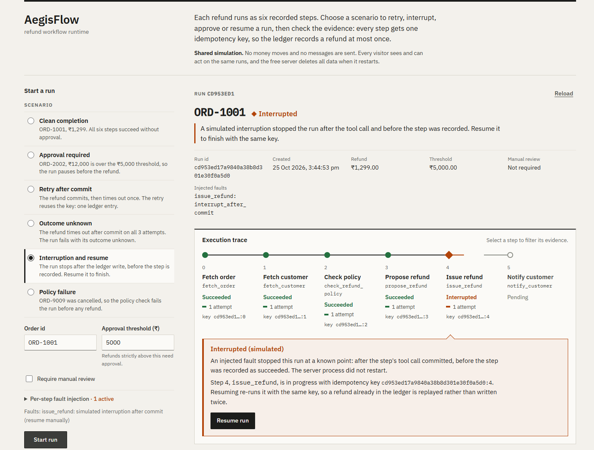
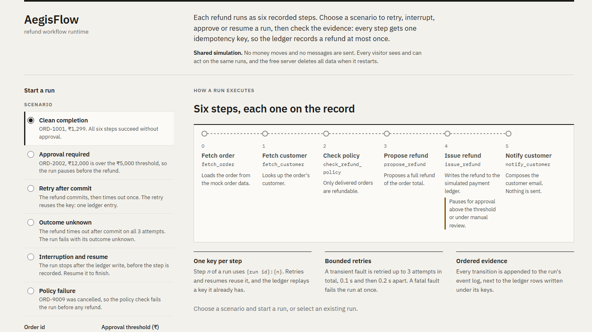

# AegisFlow

A small workflow runtime that issues refunds through six recorded steps and stays correct when things go wrong: transient faults, a crash after the payment write, a human approval gate, or a process killed mid-run. Every step gets a stable idempotency key, so retries and resumes never write a second refund.

**Live demo:** https://aegisflow-075f.onrender.com (shared simulation on Render's free tier; the first visit may take about a minute to wake the service)



*A run stopped right after `issue_refund` wrote to the simulated ledger and before the step was recorded. Resuming re-runs the step with the same key; the ledger replays it instead of writing a second refund.*

The refunds, orders, payment ledger and notifications are all simulated. Nothing calls an external system, and no LLM is involved: the pipeline and its decisions are deterministic.

## What it demonstrates

The interesting part is the window between "the payment system committed" and "the workflow recorded that it committed". A crash, timeout or retry in that window is where duplicate payments come from. AegisFlow handles it like this:

- **Stable idempotency keys.** Step *n* of a run always uses `{run_id}:{n}`. Retries and resumes reuse it. The ledger (written in its own transaction, as an external payment system would) replays a key it has already seen, and a reused key with a different order or amount is a fatal error.
- **Re-entrant execution.** A step left `started` is simply run again under its key. Earlier completed steps are never repeated.
- **Bounded, deterministic retries.** Transient faults retry up to 3 attempts in total (0.1 s, then 0.2 s; no jitter). Fatal faults fail the run immediately. If `issue_refund` exhausts its retries after its write may have committed, the run fails with `outcome_unknown: true` and the key, instead of claiming success or failure.
- **Human approval.** Refunds strictly above the scenario threshold (default ₹5,000), or flagged for manual review, pause before `issue_refund`. Only the first decision applies; a second one gets HTTP 409.
- **Single driver per run.** Starting, approving and resuming take a lease on the run inside a write transaction. A concurrent caller gets HTTP 409. A lease left by a killed process expires after 60 seconds.
- **Audit history.** Every transition is appended to an ordered event log, shown in the UI next to the ledger rows written under the run's keys.



### Execution of one step

```
step n ──► record step_started, key = {run_id}:{n}
        ──► tool call  (issue_refund commits its ledger row here, under the key)
        ──►   ◄── crash / interruption / timeout window ──►
        ──► record step_succeeded, checkpoint, move to step n+1

Retry or resume inside the window: same key ─► ledger replays the existing row ─► one refund
```

## Recovery experiment

You can reproduce three levels of failure, from simulated to real.

1. **Simulated interruption (UI or API).** Choose *Interruption and resume* and start the run. The `interrupt_after_commit` fault stops the run after `issue_refund`'s ledger write and before the step is recorded. The run stays `running`, records `run_interrupted` with the key, and the UI shows **Interrupted** with a **Resume run** button. Resuming (`POST /runs/{id}/resume`) records `run_resumed`, re-runs step 4 with the same key and attempt number, and finishes with one ledger row. This is a stop at a fixed point inside a live process, not a restart.
2. **Retry after commit.** The *Retry after commit* preset makes the refund commit and then time out once. The retry reuses the key and the ledger still has one row.
3. **Real process death (test).** `test_resume_after_real_process_death` in [`backend/tests/test_recovery.py`](backend/tests/test_recovery.py) starts a run in a child Python process, waits until it has committed the refund, and kills it (`TerminateProcess`/`SIGKILL`, so no cleanup runs). From a fresh connection the test then checks:
   - exactly one refund, step 4 still `started`, and the dead process's lease still held, so `resume` is refused with a conflict;
   - after the lease expiry time has passed (the test advances the engine's clock past 60 s rather than sleeping), `resume` succeeds, reuses the same key, leaves one refund, and produces the exact expected event sequence.

Recovery after process death needs two things: the SQLite file must survive, and someone must call resume after the lease expires. Nothing resumes runs automatically.

## Run it locally (Windows PowerShell)

You need Python 3.11+ and Node.js 20.19+.

```powershell
cd backend
python -m venv .venv
.venv\Scripts\python.exe -m pip install -e ".[dev]"

cd ..\frontend
npm install
```

Development, in two terminals:

```powershell
# API on http://127.0.0.1:8000 (SQLite file: $env:AEGISFLOW_DB, default .\aegisflow.db)
cd backend
.venv\Scripts\python.exe -m uvicorn aegisflow.api:create_app --factory --port 8000

# UI on http://localhost:5173 (proxies /api to :8000)
cd frontend
npm run dev
```

As deployed, one process serving the API and the built UI, from the repo root:

```powershell
npm run build --prefix frontend
backend\.venv\Scripts\python.exe -m uvicorn aegisflow.api:create_site --factory --port 8000
# open http://127.0.0.1:8000
```

### Tests

```powershell
cd backend
.venv\Scripts\python.exe -m pytest -q   # engine, retries, recovery and API tests

cd ..\frontend
npm run build                            # type-check and production build
```

The backend tests check behaviour and invariants: ledger rows, step and event history, terminal states, lease conflicts, concurrent approvals, migration of an older database, and the crash windows above. Tests never really sleep; backoff is replaced by a fixture.

## Architecture

```
frontend/  React + TypeScript (Vite). Calls the API at /api.
backend/   FastAPI, Pydantic v2, SQLite.
  aegisflow/engine.py   run state machine, retries, approvals, leases, event log
  aegisflow/planner.py  fixed six-step pipeline and approval policy
  aegisflow/tools.py    deterministic mock tools, orders, customers, refund ledger
  aegisflow/db.py       schema and migrations
  aegisflow/api.py      HTTP layer; create_site serves the API at /api and the UI at /
```

Pipeline: `fetch_order → fetch_customer → check_refund_policy → propose_refund → issue_refund → notify_customer`.

Runs, steps, events, checkpoints, approvals and the refund ledger live in one SQLite file. Money is integer paise everywhere.

### API

Paths are relative to the API root: `http://127.0.0.1:8000` with `create_app`, or `/api` with `create_site` and the dev proxy.

| Method | Path | Purpose |
|---|---|---|
| POST | `/runs` | Create and run a workflow: `{order_id, scenario?}` |
| GET | `/runs` | List runs |
| GET | `/runs/{id}` | Run detail with steps, pending approval and ledger rows (`refunds`) |
| GET | `/runs/{id}/events` | Ordered event history |
| POST | `/runs/{id}/approve` | `{decided_by}` |
| POST | `/runs/{id}/reject` | `{decided_by, reason?}` |
| POST | `/runs/{id}/resume` | Continue an interrupted `running` run (409 if not `running` or already being advanced) |
| GET | `/health` | Liveness and database check |

Runs execute synchronously: `POST /runs`, `/approve` and `/resume` return once the run has finished, failed, paused for approval or been interrupted.

A scenario sets `approval_threshold_paise`, `require_manual_review` and `faults`, which maps a step name to the outcome of each attempt: `retryable`, `fatal`, `retryable_after_commit` or `interrupt_after_commit`.

### Demo orders

| Order | Amount | Default scenario |
|---|---|---|
| ORD-1001 | ₹1,299 | Completes without approval |
| ORD-2002 | ₹12,000 | Pauses for approval |
| ORD-3003 | ₹499 | Pauses for approval (order flagged for manual review) |
| ORD-4004 | ₹5,000 | Completes (the threshold is strictly greater than) |
| ORD-9009 | cancelled | Fails the policy check |

## Deployment

[`render.yaml`](render.yaml) defines one free Render web service. It builds the backend and frontend, starts `uvicorn aegisflow.api:create_site`, health-checks `/api/health`, and caps the demo at 500 runs (`AEGISFLOW_MAX_RUNS`; further `POST /runs` return 429). Every push to `master` redeploys it.

| Variable | Default | Purpose |
|---|---|---|
| `AEGISFLOW_DB` | `aegisflow.db` in the current directory | SQLite file path |
| `AEGISFLOW_MAX_RUNS` | unlimited | Run cap for the public demo |
| `AEGISFLOW_FRONTEND_DIST` | `frontend/dist` in the source tree | Built UI served by `create_site` |

## Limitations

- **Simulated integrations.** Orders, customers, the payment ledger and notifications are local mocks in the same SQLite file. There are no real payments, messages or external APIs.
- **Ephemeral public demo.** Render's free tier has no persistent disk, so the database is wiped on every deploy, restart and idle spin-down. The live demo does not demonstrate recovery across a restart; the process-death recovery is shown by the test against a surviving local database.
- **Manual recovery.** Nothing scans for and resumes stuck runs, and there is no reconciliation for `outcome_unknown` runs.
- **Shared, unauthenticated demo.** Anyone can create, approve, reject or resume any run; `decided_by` is free text.
- **Single SQLite process.** The lease guards concurrent callers on one database file. This is not a distributed system, and there are no performance or scale measurements.
- **UI gaps.** The run list shows `outcome_unknown` runs as `Failed` (the list endpoint carries no events), the UI doesn't poll, and the frontend has no automated tests in the repository; it is checked by the TypeScript build and by browser runs against a local backend.
