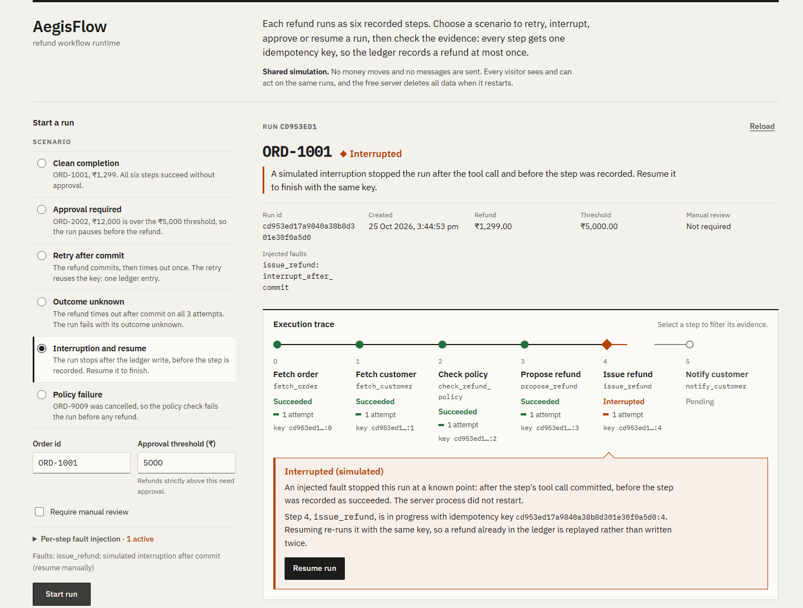
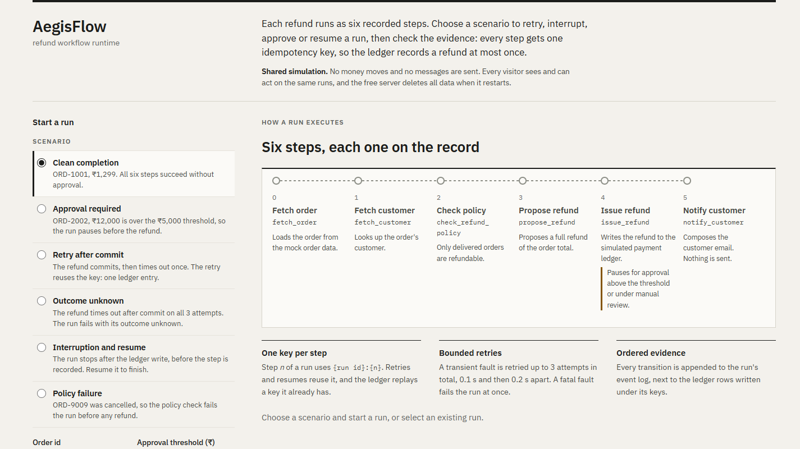

# AegisFlow

A small workflow runtime that issues refunds through six recorded steps and stays correct when things go wrong, tested by a deterministic simulator that runs the real engine through crashes, power loss, I/O errors, lost and duplicated messages, clock jumps and a payment provider that lies and forgets, and replays any failure from its seed.

**Live demo:** https://aegisflow-075f.onrender.com (shared simulation on Render's free tier; the first visit may take about a minute to wake the service)



*A run stopped right after `issue_refund` wrote to the simulated ledger and before the step was recorded. Resuming re-runs the step with the same key; the ledger replays it instead of writing a second refund.*

The refunds, orders, payment ledger and notifications are all simulated. Nothing calls an external system, and no LLM is involved: the pipeline and its decisions are deterministic.

## The claim, and how it's tested

Under crashes at any seam, power loss, I/O errors, lost, delayed, duplicated and late messages, clock jumps, and a provider that reports errors for work it did, answers with stale replies, has its status lookup go down and forgets old idempotency keys:

- each step's side effect is applied at most once, and an order is never refunded past its total;
- the ledger agrees with what the provider really did, and an outcome nobody can establish is held for review, never reported as a plain failure;
- a finished run stays finished and is never re-run from scratch;
- a run is taken from its driver only once that driver's lease is up, and a driver that has been replaced can't write;
- every run ends `succeeded`, `failed`, `rejected` or `quarantined`, with the recovery worker or a person, not luck, getting it there;
- retries respect their limit and their backoff, and a step that keeps crashing is stopped;
- durable state matches the event history;
- acknowledged work survives power loss, and a failed run says which effects committed;
- the HTTP API gives each request one run and answers only with the statuses it documents.

This is systematic testing, not a formal proof. The evidence:

- **A deterministic simulator** (`backend/aegisflow/sim/`). The real engine runs on baton-passing threads against real SQLite, and a seed decides the interleaving, the clock and the faults. Some seeds drive it through the real FastAPI app in process. The same seed gives the same run, byte for byte.
- **A history checker** with 33 named invariants, which shares no logic with the engine.
- **Negative controls.** 30 known bugs, put back as exact source edits. Each is caught within a stated number of seeds.
- **Regression tests** pinning a seed per bug that passes on the fixed code and fails with the bug put back.

At `45e07e7`, all 30 controls were caught within 440 seeds (`controls --max-seeds 3000`, 202 s), and a survey of seeds 0 to 3,999 (631.4 s) fired no invariant. A clean range is evidence about those seeds, not proof that no bug remains.

[WALKTHROUGH.md](WALKTHROUGH.md) explains how this works and where it stops. [STUDY.md](STUDY.md) has questions and answers by stage.

### Bugs found

The audit found these by hand first. The simulator then re-found each one on the unfixed engine, with `survey --seeds 6000` at commit `005e746`. After those fixes it found no engine bugs until the hardening work. Driving clients through the HTTP layer, it then found one nobody had predicted: `POST /runs` answered 409 for a run it had just created, if another driver took the run over before the reply (fixed in `15706ec`). Everything else it reported was a mistake in the checker, the workload or the simulator itself, including every seed the scheduled 100,000-seed runs failed, and one seed from the final survey. Details, schedules and the control results are in [docs/BUGS_FOUND.md](docs/BUGS_FOUND.md).

| Audit | Bug | Seeds to re-find | Fix |
|---|---|---:|---|
| P5 | Opening a connection takes the write lock, even to read | 3 | `4213f93` |
| P3 | A repeated request refunds an order twice | 4 | `0a09e56` |
| P3 | The same request runs as two runs | 7 | `ada9639` |
| P6 | `notify_customer` delivers twice after a crash | 4 | `9c99d58` |
| P2 | A driver writes after losing its lease | 14 | `70e9855` |
| P7 | A run fails after its refund committed, without saying so | 15 | `2b96f5e` |
| P1 | A committed refund, then a fatal error, reports plain `failed` | 257 | `7db7bb2` |
| P4 | A retry skips its backoff after a crash or takeover | 1,546 | `1290ae8` |

### Run the simulator

```powershell
cd backend
.venv\Scripts\python.exe -m aegisflow.sim run --seeds 1000             # add --budget-seconds N to stop on time
.venv\Scripts\python.exe -m aegisflow.sim replay --seed 42 --trace     # one seed, every scheduling step
.venv\Scripts\python.exe -m aegisflow.sim survey --seeds 5000          # seeds each invariant takes to break
.venv\Scripts\python.exe -m aegisflow.sim controls                     # put known bugs back, count seeds to catch
```

A failing seed prints a minimal `reproduce:` command. CI runs up to 5,000 seeds on a 420 s budget on every push, and a nightly workflow covers a new seed range and can be started by hand for longer runs. `controls --mode all` turns every feature on for every seed, to compare with the default swarm mode.

## What it demonstrates

The interesting part is the window between "the payment system committed" and "the workflow recorded that it committed". A crash, timeout or retry in that window is where duplicate payments come from. AegisFlow handles it like this:

- **Stable idempotency keys.** Step *n* of a run always uses `{run_id}:{n}`. Retries and resumes reuse it. The ledger (written in its own transaction, as an external payment system would) replays a key it has already seen, and a reused key with a different order or amount is a fatal error.
- **Re-entrant execution.** A step left `started` is simply run again under its key. Earlier completed steps are never repeated.
- **Bounded, deterministic retries.** Transient faults retry up to 3 attempts in total (0.1 s, then 0.2 s; no jitter). The backoff is stored with the step, so whoever picks the step up waits out the rest of it. A run that fails later names the effects already committed.
- **Reconciliation before retry.** An error from the provider doesn't say whether the refund happened: the reply may have been lost, stale, or plain wrong. So before calling a side-effecting step again, and before reporting any error from one, the engine looks the key up with the provider. If the refund is there, the step is recorded as done (`step_reconciled`) with no second call. "No record" is trusted only while the key is under 5 minutes old (`KEY_TRUST_S`), which assumes the provider keeps keys longer than that, and only as grounds to retry under the same key, never as proof of failure. Anything the lookup can't settle puts the run in `needs_review` with the key. The recovery worker asks again on each sweep (so can **Re-check** in the UI), and a person can settle it with **It happened** or **It did not happen**. A person can't deny a refund the provider shows.
- **Recovery without a person.** A background worker in the API process (every 30 s; `AEGISFLOW_RECOVERY_INTERVAL_S`, 0 turns it off) resumes runs whose driver's lease has expired. It takes the lease and the fencing token like any other driver. A step that kills its driver 3 times (`MAX_CRASHES`) puts the run in `quarantined`, which nothing resumes. Interrupted runs are left for a person, as the demo intends.
- **Human approval.** Refunds strictly above the scenario threshold (default ₹5,000), or flagged for manual review, pause before `issue_refund`. Only the first decision applies; a second one gets HTTP 409.
- **Single driver per run.** Starting, approving and resuming take a lease on the run inside a write transaction. A concurrent caller gets HTTP 409. A lease left by a killed process expires after 60 seconds. Expiry alone can't stop a stalled driver from carrying on, so each claim also increments a fencing token, and every write checks it in the same transaction.
- **One run per request, one refund up to the total.** An optional `Idempotency-Key` on `POST /runs` maps a client request to one run. A database trigger refuses any refund that takes an order past its total.
- **Audit history.** Every transition is appended to an ordered event log, shown in the UI next to the ledger rows written under the run's keys.



### Execution of one step

```
step n ──► record step_started, key = {run_id}:{n}
        ──► tool call  (issue_refund commits its ledger row here, under the key)
        ──►   ◄── crash / interruption / timeout window ──►
        ──► record step_succeeded, checkpoint, move to step n+1

Retry or resume inside the window: same key ─► ledger replays the existing row ─► one refund
```

## Recovery experiment

You can reproduce three levels of failure, from simulated to real.

1. **Simulated interruption (UI or API).** Choose *Interruption and resume* and start the run. The `interrupt_after_commit` fault stops the run after `issue_refund`'s ledger write and before the step is recorded. The run stays `running`, records `run_interrupted` with the key, and the UI shows **Interrupted** with a **Resume run** button. Resuming (`POST /runs/{id}/resume`) records `run_resumed`, re-runs step 4 with the same key and attempt number, and finishes with one ledger row. This is a stop at a fixed point inside a live process, not a restart.
2. **Retry after commit.** The *Retry after commit* preset makes the refund commit and then time out once. The retry reuses the key and the ledger still has one row.
3. **Real process death (test).** `test_resume_after_real_process_death` in [`backend/tests/test_recovery.py`](backend/tests/test_recovery.py) starts a run in a child Python process, waits until it has committed the refund, and kills it (`TerminateProcess`/`SIGKILL`, so no cleanup runs). From a fresh connection the test then checks:
   - exactly one refund, step 4 still `started`, and the dead process's lease still held, so `resume` is refused with a conflict;
   - after the lease expiry time has passed (the test advances the engine's clock past 60 s rather than sleeping), `resume` succeeds, reuses the same key, leaves one refund, and produces the exact expected event sequence.

Recovery after process death needs the SQLite file to survive. With the API server up, its recovery worker picks the run up once the lease expires (`backend/tests/test_sweep.py`); without it, someone calls resume.

The *Outcome unknown* preset shows the other side: the refund commits, the reply is lost, and the provider's status lookup is down, so the run stops in `needs_review` instead of guessing. The scenario keeps the lookup down, so **Re-check** keeps failing and a person has to settle it. While the lookup is down, nothing stops that person from answering **It did not happen** for a refund that did happen (see Limitations).

## Run it locally (Windows PowerShell)

You need Python 3.11+ and Node.js 20.19+.

```powershell
cd backend
python -m venv .venv
.venv\Scripts\python.exe -m pip install -e ".[dev]"

cd ..\frontend
npm install
```

Development, in two terminals:

```powershell
# API on http://127.0.0.1:8000 (SQLite file: $env:AEGISFLOW_DB, default .\aegisflow.db)
cd backend
.venv\Scripts\python.exe -m uvicorn aegisflow.api:create_app --factory --port 8000

# UI on http://localhost:5173 (proxies /api to :8000)
cd frontend
npm run dev
```

As deployed, one process serving the API and the built UI, from the repo root:

```powershell
npm run build --prefix frontend
backend\.venv\Scripts\python.exe -m uvicorn aegisflow.api:create_site --factory --port 8000
# open http://127.0.0.1:8000
```

### Tests

```powershell
cd backend
.venv\Scripts\python.exe -m pytest -q   # engine, retries, recovery, API and simulator tests
.venv\Scripts\python.exe -m ruff check .
.venv\Scripts\python.exe -m mypy

cd ..\frontend
npm run build                            # type-check and production build
```

The backend tests check behaviour and invariants: ledger rows, step and event history, terminal states, lease conflicts, concurrent approvals, migration of an older database, and the crash windows above. Tests never really sleep; backoff is replaced by a fixture. `tests/test_seams.py` fails if engine code reaches time, randomness, storage or the network other than through `aegisflow/runtime.py`.

## Architecture

```
 React UI ──► api.py ──► engine.py ──► planner.py     pure next-step and approval decisions
 (Vite)       HTTP         │ state machine, retries, leases and fencing, event log
                           ▼
                       runtime.py   the seams: clock, ids, sleep, open_db, invoke, ledger
                        │       │
          production    │       │    simulator (aegisflow/sim/)
          ──────────    │       │    ─────────────────────────
          real clock    │       │    scheduler.py  seeded baton-passing, simulated time
          sqlite3 file ◄┘       └──► storage.py    real SQLite, crash images, I/O faults
          tools.py ledger            world.py      faults, external system, clients
                                     workload.py   what each seed asks for
                                     asgi.py       clients calling the real FastAPI app
                                     checker.py    33 invariants, watching from outside
                                     mutations.py  known bugs, as exact source edits
```

- `aegisflow/engine.py`: run state machine, retries, reconciliation, approvals, leases, quarantine, event log
- `aegisflow/recovery.py`: one sweep of the recovery worker
- `aegisflow/planner.py`: fixed six-step pipeline and approval policy
- `aegisflow/tools.py`: deterministic mock tools and refund ledger; `demo_data.py`: the order pool
- `aegisflow/db.py`: schema and migrations
- `aegisflow/api.py`: HTTP layer; `create_site` serves the API at `/api` and the UI at `/`

Pipeline: `fetch_order → fetch_customer → check_refund_policy → propose_refund → issue_refund → notify_customer`.

Runs, steps, events, checkpoints, approvals and the refund ledger live in one SQLite file. Money is integer paise everywhere. The `checkpoints` table holds audit snapshots; recovery rebuilds state from steps and doesn't read it.

### API

Paths are relative to the API root: `http://127.0.0.1:8000` with `create_app`, or `/api` with `create_site` and the dev proxy.

| Method | Path | Purpose |
|---|---|---|
| POST | `/runs` | Create and run a workflow: `{order_id, scenario?}`. With an `Idempotency-Key` header, a repeat returns the same run with 200, and the key on a different request gets 409 |
| GET | `/orders/available` | The next order of each kind with something left to refund |
| GET | `/runs` | List runs |
| GET | `/runs/{id}` | Run detail with steps, pending approval and ledger rows (`refunds`) |
| GET | `/runs/{id}/events` | Ordered event history |
| POST | `/runs/{id}/approve` | `{decided_by}` |
| POST | `/runs/{id}/reject` | `{decided_by, reason?}` |
| POST | `/runs/{id}/resume` | Continue an interrupted `running` run (409 if not `running` or already being advanced) |
| POST | `/runs/{id}/reconcile` | Ask the provider again about a `needs_review` run |
| POST | `/runs/{id}/resolve` | `{decided_by, outcome}` with `applied` or `not_applied`: a person settles a `needs_review` run (409 for `not_applied` while the provider shows the effect) |
| GET | `/health` | Liveness and database check |

Runs execute synchronously: `POST /runs`, `/approve` and `/resume` return once the run has finished, failed, paused for approval or been interrupted.

A scenario sets `approval_threshold_paise`, `require_manual_review`, `provider_status_down` and `faults`, which maps a step name to the outcome of each attempt: `retryable`, `fatal`, `retryable_after_commit` or `interrupt_after_commit`.

### Demo orders

An order can be refunded only up to its total, so the demo seeds a pool of each kind. The UI picks the next usable one.

| Orders | Amount | Default scenario |
|---|---|---|
| ORD-1001 to ORD-1500 | ₹1,299 | Completes without approval |
| ORD-2002 to ORD-2101 | ₹12,000 | Pauses for approval |
| ORD-3003 to ORD-3052 | ₹499 | Pauses for approval (order flagged for manual review) |
| ORD-4004 to ORD-4053 | ₹5,000 | Completes (the threshold is strictly greater than) |
| ORD-9009 | cancelled | Fails the policy check |

## Deployment

[`render.yaml`](render.yaml) defines one free Render web service. It builds the backend and frontend, starts `uvicorn aegisflow.api:create_site`, health-checks `/api/health`, and caps the demo at 500 runs (`AEGISFLOW_MAX_RUNS`; further `POST /runs` return 429). Every push to `master` redeploys it.

| Variable | Default | Purpose |
|---|---|---|
| `AEGISFLOW_DB` | `aegisflow.db` in the current directory | SQLite file path |
| `AEGISFLOW_MAX_RUNS` | unlimited | Run cap for the public demo |
| `AEGISFLOW_FRONTEND_DIST` | `frontend/dist` in the source tree | Built UI served by `create_site` |
| `AEGISFLOW_RECOVERY_INTERVAL_S` | `30` | Seconds between recovery sweeps; `0` turns the worker off |

## Limitations

- **Fsync behaviour is modelled, not observed.** Stdlib `sqlite3` has no hook on fsync, so the simulator derives what would survive power loss from SQLite's documentation of `synchronous=FULL` in WAL mode. It doesn't test whether a disk honours a sync.
- **WAL checkpoint crashes are not covered.** Auto-checkpointing is off in the simulator, so crashes during a checkpoint and torn pages in the main database file are outside what's tested.
- **A clean run isn't a proof.** Results hold for the fault model, the workload and the seeds reported. The invariants and the engine share an author, and threads take turns, so real parallelism is tested only by the process-death test.
- **Wall-clock backoff and key age.** A forward clock jump can shorten a backoff. Key age is also measured on the wall clock, so a backward jump could make an old key look young enough to trust a "no record" from a provider that has forgotten it. The reasoning says this hole exists; the simulator has never reached it.
- **A person can be wrong.** While the status lookup is down, **It did not happen** is accepted with nothing to check it against, even if the refund exists. **It happened** is accepted whenever the provider has no record, which is the point when it has forgotten the key and an error when the refund never went out. Either way the run's record names the person who decided.
- **The provider is still a mock.** It now lies, goes stale, loses its status lookup and forgets keys, but only in the ways the simulator's author thought of, and `KEY_TRUST_S` assumes a retention window that a real provider would have to document.
- **Simulated integrations.** Orders, customers, the payment ledger and notifications are local mocks in the same SQLite file. There are no real payments, messages or external APIs.
- **Ephemeral public demo.** Render's free tier has no persistent disk, so the database is wiped on every deploy, restart and idle spin-down. The live demo does not demonstrate recovery across a restart; the process-death recovery is shown by the tests against a surviving local database.
- **One worker, in the API process.** Recovery runs only while the server is up, and a free Render service sleeps when idle, so a run abandoned there waits until the next visit wakes it.
- **Shared, unauthenticated demo.** Anyone can create, approve, reject, resume or settle any run; `decided_by` is free text.
- **Single SQLite process.** The lease guards concurrent callers on one database file. This is not a distributed system, and there are no performance or scale measurements.
- **UI gaps.** The UI doesn't poll, and the frontend has no automated tests in the repository; it is checked by the TypeScript build and by browser runs.
